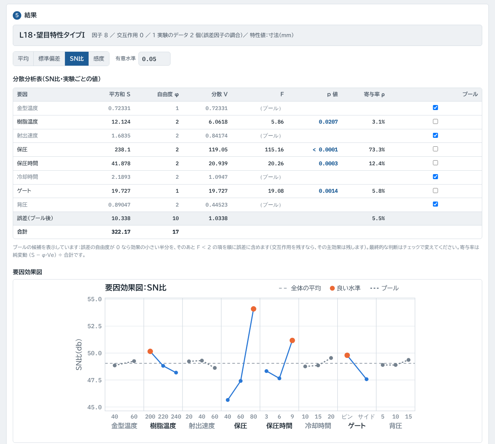
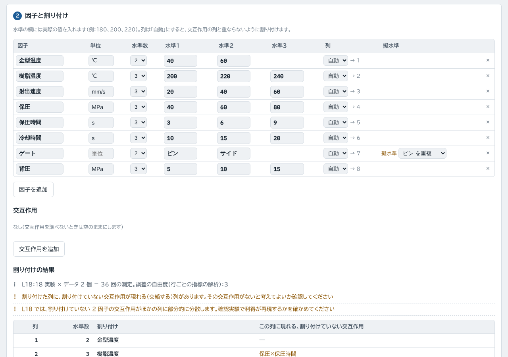

# 実験計画法（doe-calc）

品質管理のための実験計画法の Web ツールです。因子を**直交表**（L4・L8・L9・L12・L16・L18）に割り付け、実験順序表を作り、データから**分散分析**・**要因効果図**・最適条件の推定までを計算します。タグチメソッドの **SN比**・**2 段階設計**・**確認実験**の判定にも対応しています。

**https://kotaooka.github.io/doe-calc/**

インストールは不要で、ブラウザで開くだけで使えます。

- **データは外に出ません**。計算はすべてブラウザの中で行い、どこにも送信しません
- 画面の字体（BIZ UDPゴシック・IBM Plex Mono）は Google Fonts から読み込むため、開いたときに Google のサーバーへ接続します。入力したデータは送りません
- 入力した値はこの端末のブラウザに自動で保存し、次に開いたときに続きから使えます。計画とデータは JSON ファイルにも保存できます
- 一度開けば**オフラインでも動きます**。スマートフォンやPCにアプリとして追加することもできます

---

## 使い方

1. **計画**：特性値と特性の種類（望小・望大・望目タイプI／II）、直交表、1 つの実験で取るデータ（繰り返し、または誤差因子の調合 N1・N2 など）を決めます
2. **因子と割り付け**：因子ごとに水準の実際の値と単位を入れ、調べたい交互作用を指定します。列は自動で割り付け、交絡する交互作用を表示します。列を指定することもできます
3. **実験順序表**：ランダムな順番の表を、水準の実際の値で表示します。印刷・CSV 保存ができます
4. **解析**：データを入れる（Excel から貼り付け可）と、分散分析・要因効果図・推定を表示します。「サンプル」で動作を確認できます
5. **確認実験**：最適条件と現行条件のデータを入れると、利得が再現したかを判定します

## 機能

| 機能 | 内容 |
|---|---|
| 直交表 | L4・L8・L9・L12・L16・L18（田口の標準形の列の並び） |
| 割り付け | 交互作用の列の自動決定（L4・L8・L16・L9、L18 は列1×列2）、交絡の表示と衝突の警告、**擬水準法**（3 水準の列に 2 水準の因子） |
| 実験順序表 | ランダム化（繰り返しは全測定を並べ替え）、水準の実際の値で表示、印刷・CSV |
| 指標 | 平均・標準偏差・SN比（望小・望大・望目タイプI／II）・感度を切り替え |
| 分散分析 | 平方和・自由度・分散・F・p 値・寄与率。繰り返しの誤差 e₂ と空き列などの誤差 e₁ を表示。**プールの候補**（誤差の自由度 0 なら効果の小さい半分、そのあと F < 2）を示し、チェックで変更 |
| グラフ | 要因効果図（全因子を縦軸をそろえて並べる）、交互作用図。PNG で保存 |
| 2 段階設計 | 望目特性で、SN比を上げる因子・調整因子・どちらにも効かない因子に分類 |
| 推定 | 最適条件・現行条件の推定値と信頼区間、利得とその信頼区間、有効反復数、確認実験の予測区間 |
| 確認実験 | 利得の再現率（許容幅は変更可、既定 ±30%）と、予測区間に入るかの判定 |
| 保存 | JSON での保存と読み込み、レポートの印刷・PDF |

## 使うときの注意

- データに空欄があると直交性が崩れるので解析しません
- L12・L18 では、割り付けていない交互作用がほかの列に部分的に分散します。確認実験で利得が再現するかを必ず確かめてください
- 多水準作成法、動特性、外側直交表の割り付けには対応していません
- 計算結果は判断材料としてお使いください

---

## 計算の検証

計算は外部ライブラリを使わずに実装し、別の方法で計算した値と照合するテストを付けています（push のたびに GitHub Actions で実行）。

- 直交表：教科書の表を書き写したもの（L16 は基本列の積で別に作ったもの）と一致すること、直交していること
- 平方和・自由度・F・p 値・寄与率：statsmodels の最小二乗法（区分の変数）と anova_lm の値と照合。擬水準、L18 の列1×列2 の交互作用、L9 の 2 列を使う交互作用、誤差の自由度 0 の場合を含む 8 通りのデータで確認
- 推定値・信頼区間・予測区間・有効反復数・利得：プールしていない項だけのモデルを statsmodels で当てはめた値と照合
- SN比・感度：式どおりの手計算の値と照合
- 自動割り付け：交互作用の列がほかの因子・交互作用と重ならないこと、割り付けられない組み合わせを検出すること

開発者向けの情報は [DEVELOPMENT.md](DEVELOPMENT.md) にあります。

## ライセンス

[MIT License](LICENSE)
